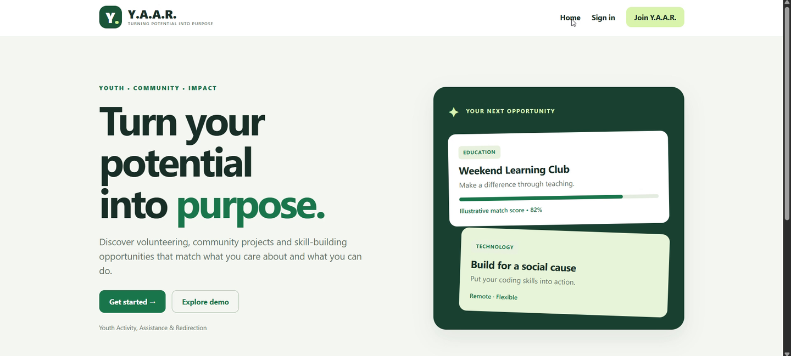
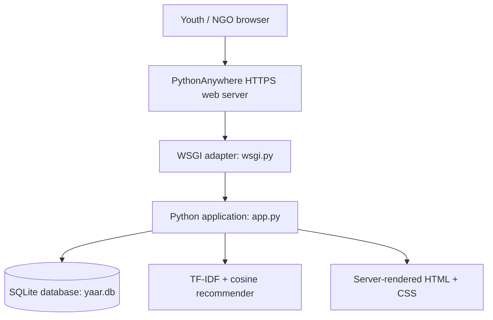
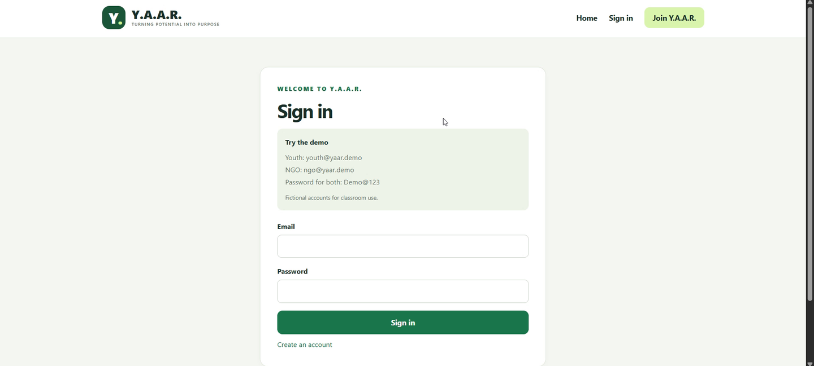
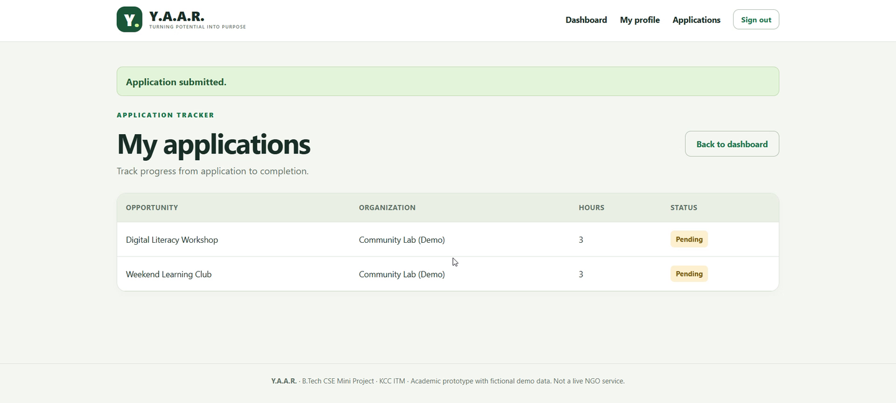

<div align="center">

# Y.A.A.R.
### Youth Activity, Assistance & Redirection
**Turning Potential into Purpose.**
🌐 **Live Demo:** [Visit Y.A.A.R. Website](https://divyanshvardhan1.pythonanywhere.com/)

A web-based academic prototype connecting young people with volunteering, community projects and skill-development opportunities through content-based recommendations.


**[🌐 View Live Demo](https://divyanshvardhan1.pythonanywhere.com)** · [How it works](#how-it-works) · [Run locally](#run-locally) · [Deploy](docs/DEPLOY_PYTHONANYWHERE.md)

</div>



> **Academic demo only:** The opportunities and demo NGO are fictional. This is not an operational/verified NGO network. Use fictional test details; do not enter real sensitive information.

## 🎯 The problem

Young people have useful skills and an interest in making a difference, but discovering suitable, accessible opportunities is often difficult. At the same time, NGOs and community organizers need a way to reach relevant volunteers. **Y.A.A.R.** provides a prototype platform to connect both sides.

## ✨ Features

| Youth | NGO / Organization |
|---|---|
| Create an account and sign in | Create an organization account and sign in |
| Add skills, interests, location and availability | Publish opportunities and required skills |
| View ranked opportunity recommendations | View received applications |
| Apply to a project once | Accept, reject or mark accepted work as completed |
| Track application status | Track published projects and applications |

## 🧠 How it works

**Content-based recommendation:** The application tokenizes youth profile text and opportunity descriptions; computes smoothed **TF-IDF** vectors and **cosine similarity**; and applies simple location and availability bonuses.

```text
Match score = round(100 × (0.80 × cosine_similarity
                        + 0.10 × location_fit
                        + 0.10 × availability_fit))
```

Scores are **relative relevance heuristics**, not probabilities of selection or employment. The recommendation technique is deterministic, not generative AI. No ChatGPT API, TensorFlow, Flask or scikit-learn is used in this version.



More details: [Architecture & database notes](docs/ARCHITECTURE.md).

## 🛠️ Built with

- **Python 3.11**, standard library `http.server` (local server), `wsgiref`-compatible WSGI adapter (cloud hosting), `sqlite3`, `hashlib`, `secrets`, `math` and `collections`.
- **HTML5** rendered by Python and **CSS3** in `static/style.css`.
- **SQLite** for user accounts, opportunities, applications and session records.
- **PythonAnywhere** for the hosted academic demo.
- **No third-party packages required.**

## 🚀 Run locally

Requirements: Python **3.8+** (Python **3.11** used for the hosted demo).

```bash
python app.py
```

Open **http://127.0.0.1:8765**. On Windows, you can instead double-click `START-YAAR.bat` (Python must be installed).

On first run, the application creates a local `yaar.db` with fictional example opportunities and demo accounts:

| Role | Email | Password |
|---|---|---|
| Youth | `youth@yaar.demo` | `Demo@123` |
| NGO | `ngo@yaar.demo` | `Demo@123` |

These demo accounts are **publicly known** and must not be used for private or real-world data. Public deployment should disable/replace shared demo credentials before being considered production-ready.

### Quick demo walkthrough
1. Sign in as a **youth**; open **My profile** and edit skills/interests.
2. Go to **Dashboard**, inspect match scores and apply to a relevant opportunity.
3. Sign out; sign in as the **NGO** and open **Applicants**.
4. Accept or reject the application; sign back in as youth to check its status.

## 🧪 Run tests

```bash
python -m unittest discover -s tests -v
```

The tests use a temporary SQLite database and do not modify your live website database. For a manual demo/test plan, see [Testing Checklist](docs/TESTING_CHECKLIST.md).

## 📸 Screenshots

| Homepage | Sign in |
|---|---|
|  |  |



Screenshots were taken from a local recording of the hosted academic prototype. Add updated images when your design changes, after checking that no personal data is visible.

## 📁 Project structure

```text
YAAR_GitHub_Ready/
├── app.py                       # Routes, HTML, SQLite and recommendations
├── wsgi.py                      # PythonAnywhere compatibility adapter
├── START-YAAR.bat               # Optional local Windows launcher
├── static/
│   └── style.css                # Responsive UI styles
├── screenshots/                 # Demo screenshots for this README
├── docs/
│   ├── ARCHITECTURE.md
│   ├── DEPLOY_PYTHONANYWHERE.md
│   └── TESTING_CHECKLIST.md
├── tests/
│   └── test_core.py
├── .gitignore                   # Prevents uploading runtime databases/secrets
└── README.md
```

**`yaar.db` is deliberately not committed.** Each local/server deployment creates its own database. Uploading source changes to GitHub does **not** automatically update an existing PythonAnywhere site.

## 🌱 Future scope

- Organization verification and moderation
- Email confirmations and password-reset flow
- Real, verified volunteering opportunities
- Better recommendations using feedback and richer profiles
- Accessibility audits, analytics and responsible public deployment

## 👩‍💻 Team and academic context

**Course:** B.Tech Computer Science & Engineering, Semester V — Mini Project (BCS554)  
**Institute:** KCC Institute of Technology and Management, Greater Noida (AKTU)

**Contributors:** Add each team member's name and GitHub profile link here after confirming their contribution.  
**Project guide:** Add the faculty guide's name when confirmed.

> Development note: This repository contains an academic prototype built with coding assistance. Update the documentation to accurately reflect the team's implementation, testing and understanding before submission.

## 📄 License

No open-source license has been chosen yet. You can add one later if all contributors agree to publish this project under its terms.
