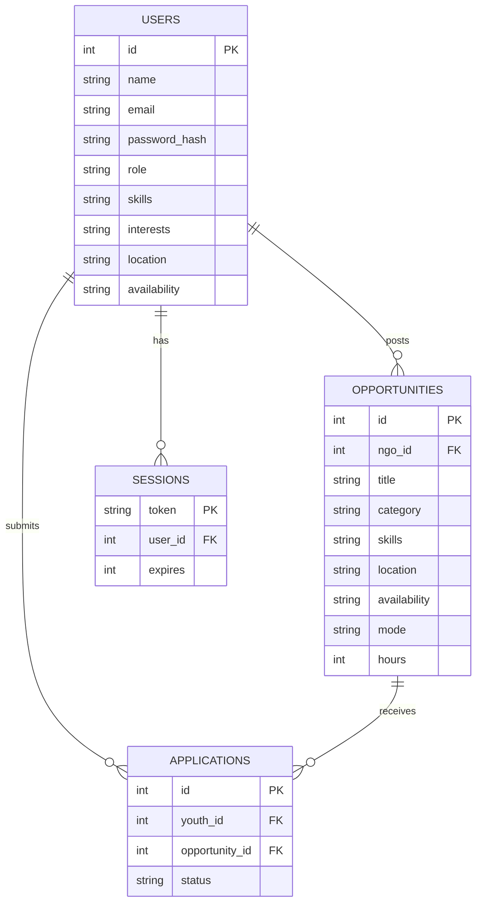

# Architecture and data model

## Application flow

1. A visitor sends a browser request to PythonAnywhere (or the local `http.server`).
2. PythonAnywhere calls the `application` callable in `wsgi.py` (WSGI).
3. `wsgi.py` translates the request to the request handler in `app.py`.
4. `app.py` validates the request, retrieves or changes SQLite records, and renders HTML.
5. The content-based recommender ranks opportunities for a youth account.

## Database tables (`sqlite3`)

| Table | Meaning | Main relationships |
|---|---|---|
| `users` | Youth and NGO profiles, login credential hashes and preferences | `users.id` primary key |
| `opportunities` | NGO-posted projects and requirements | `ngo_id` → `users.id` |
| `applications` | Youth applications and status | `youth_id` → `users.id`; `opportunity_id` → `opportunities.id` |
| `sessions` | Temporary logged-in sessions | `user_id` → `users.id` |

## Recommendation method

1. Collect a youth's **skills** and **interests**.
2. Tokenize profile and opportunity content and remove a small stopword list.
3. Compute term counts and document frequencies, then smoothed TF-IDF weights.
4. Compare vectors using cosine similarity.
5. Add location and availability bonuses, rank results, and show overlap explanations.

The code uses weights 80% text relevance, 10% location, 10% availability. This is a **relevance score**, not a statistical confidence/probability; no learned training model is involved.

## Current limitations

- Demo NGO and opportunities are fictional and unverified.
- Text matching is token-based; it does not understand every synonym or context.
- Shared sample accounts are for classroom demonstration only.
- This is a small prototype and has not undergone a production security or load audit.
